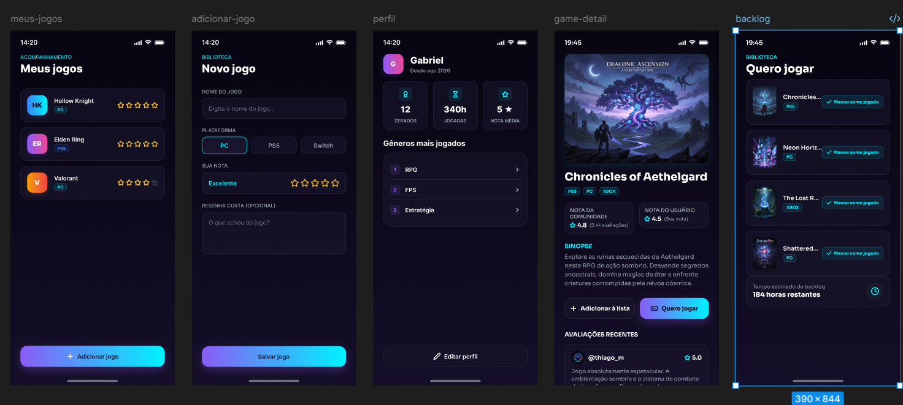
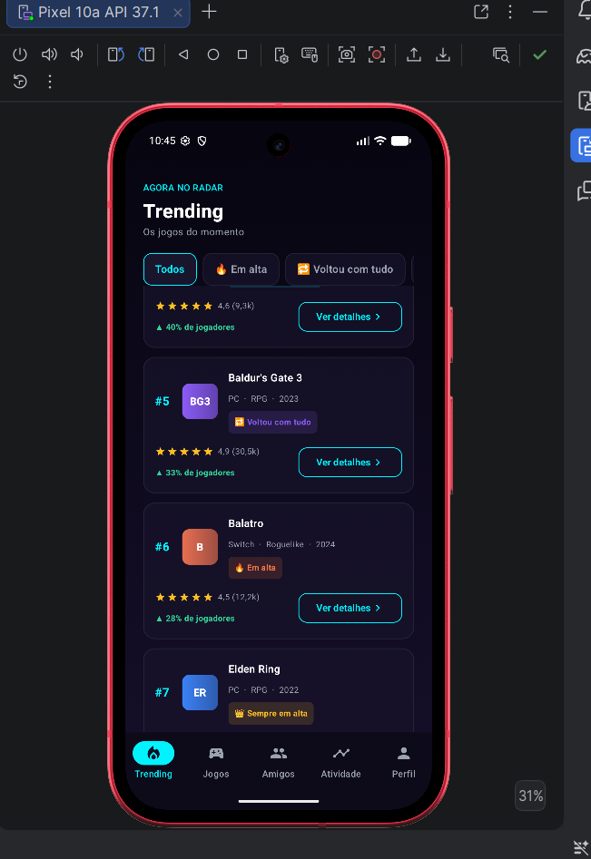
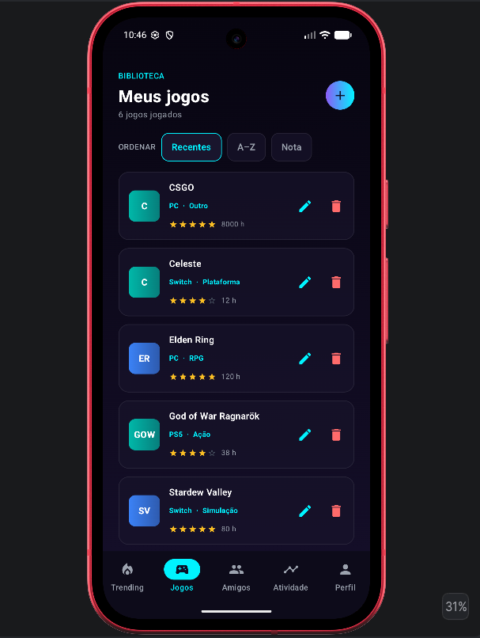
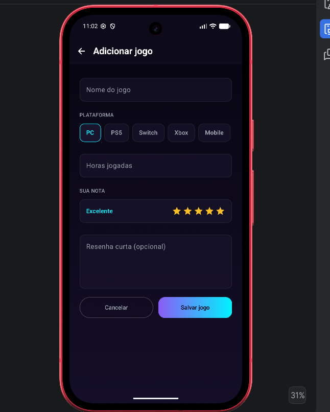
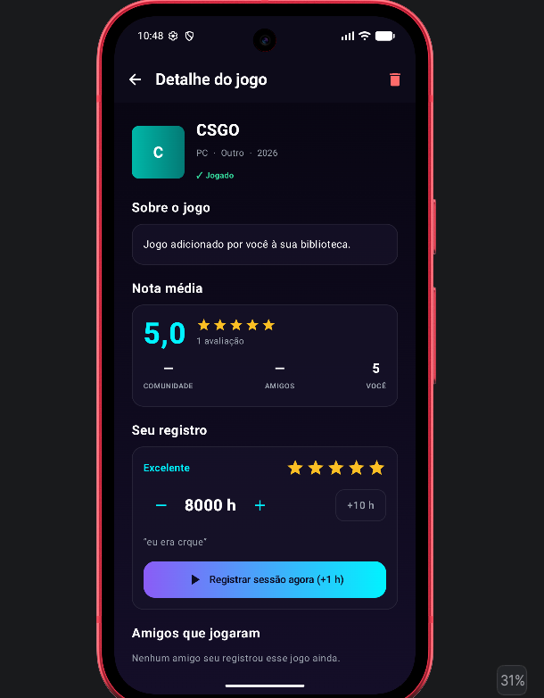
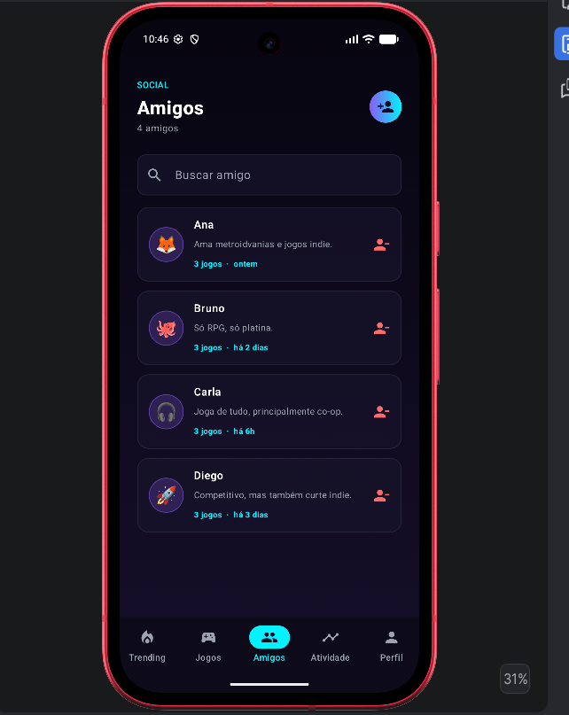
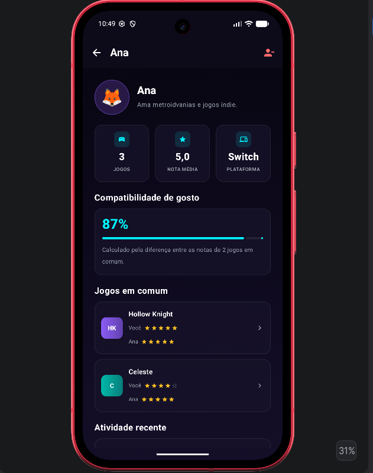
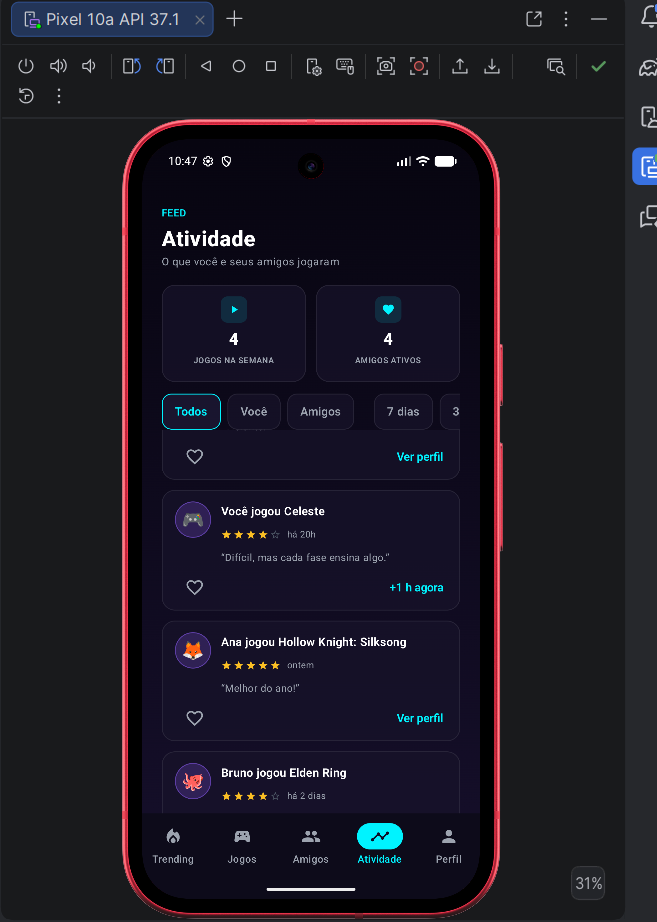
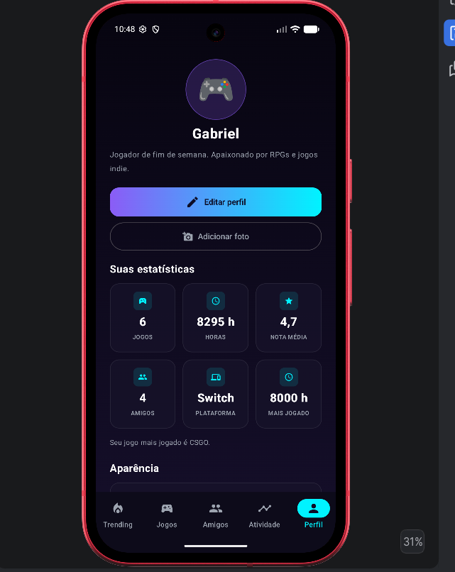
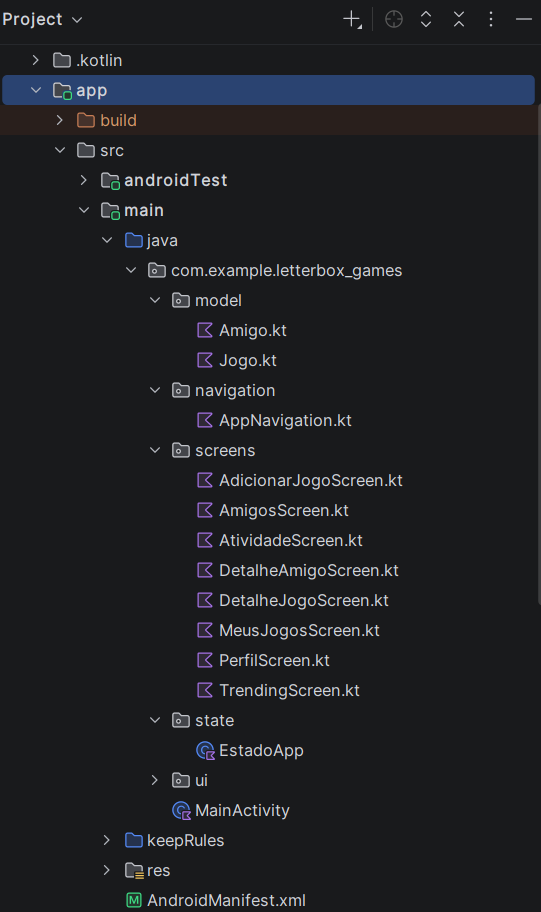

# GABRIEL CONSULO
# GUSTAVO MACEDO
# MATHEUS HENRIQUE FARIAS DE JESUS

# Processo e decisões do trio — Trabalho 2 (MAF)

**App:** Letterbox Games — um diário de jogos social, parecido com o Letterboxd, mas para games.
**Integrantes:** _preencher com os nomes do trio_

---

## 1. Como estava o projeto no Trabalho 1 e o que mudou

No Trabalho 1 o app tinha **3 telas**: lista de jogos, formulário de novo jogo e perfil. A troca de telas era
feita por um `enum` (`TelaAtual`) com um `when`, ou seja, não era navegação de verdade, só um estado que
decidia qual tela desenhar. Os jogos ficavam salvos no próprio celular (`SharedPreferences`).

No Trabalho 2 mudamos a base do app:

- A troca de telas passou a usar **`NavHost` e `NavController`**, com todas as rotas num objeto `Rotas`.
- Criamos uma **barra de navegação inferior** de verdade, com 5 áreas.
- O app foi de 3 para **8 telas**.
- Os dados passaram a ficar **só na memória** (`mutableStateListOf`), como o enunciado pede. Tiramos o
  `SharedPreferences` do Trabalho 1.
- Todo botão e todo item clicável agora faz alguma coisa (navega, abre popup, edita ou remove).
- Criamos uma segunda lista de itens (**Amigos**) e uma terceira data class (**Atividade**) que liga jogos e amigos.
- Adicionamos **modo escuro e modo claro** (bônus).

---

## 2. Passo a passo do que fizemos

1. **Planejamos as telas** e o que cada uma faria, olhando o enunciado e a checklist do professor.
2. **Criamos o modelo de dados:** `Jogo`, `Amigo` e `Atividade`.
3. **Criamos a classe `EstadoApp`**, que guarda todas as listas e as regras (adicionar, remover, editar).
4. **Montamos a navegação:** objeto `Rotas`, `NavHost` e a barra inferior.
5. **Construímos as telas** uma por uma, começando pelas listas e depois pelos detalhes.
6. **Criamos o tema claro e escuro** e ligamos ao interruptor do Perfil.
7. **Testamos no emulador/celular**, clicando em todos os botões.
8. **Tiramos os prints**, escrevemos esta documentação e subimos tudo para um repositório novo no GitHub.

---

## 3. Por que essas telas e o que cada uma faz

| Tela | O que faz | Por que escolhemos |
|---|---|---|
| **Trending** | Mostra os jogos do momento (em alta, voltaram, lançamentos, sempre em alta). Tem filtros por motivo, um carrossel "Hype da semana" e o botão **Ver detalhes**, que abre o Detalhe do Jogo | É a porta de entrada: descobrir o que jogar |
| **Meus Jogos** | Lista dos jogos já jogados. Dá para ordenar por recentes, A–Z e nota. O lápis abre um popup para editar e a lixeira remove | É a lista principal do app e vem do Trabalho 1 |
| **Adicionar Jogo** | Formulário com nome, plataforma, horas, nota e resenha | Já existia no Trabalho 1; ganhou campos novos |
| **Detalhe do Jogo** | Descrição, nota média e ações sobre o jogo | Detalhe da lista de jogos |
| **Amigos** | Lista de amigos com busca. Adicionar amigo por formulário e remover | Segunda lista obrigatória, com outra data class |
| **Detalhe do Amigo** | Estatísticas, compatibilidade de gosto, jogos em comum e atividade | Detalhe da lista de amigos (o enunciado exige um detalhe por lista) |
| **Atividade** | Feed com o que você e os amigos jogaram, com filtros, curtir e "+1 h" | Dá vida ao app e usa os dados dos amigos |
| **Perfil** | Foto ou ícone, nome, sobre, estatísticas e modo escuro/claro | Já existia no Trabalho 1; ganhou foto, edição e tema |

Nosso plano inicial tinha 7 telas e só um detalhe. Como o enunciado exige **um detalhe para cada lista**,
acrescentamos o **Detalhe do Amigo** como 8ª tela. O mínimo de 7 continua cumprido.

### Adicionar e remover nas duas listas

**Meus Jogos:** o botão **+** do topo abre o formulário e o jogo novo aparece na lista. A lixeira remove (com
confirmação). O lápis abre um popup para editar nota, horas e resenha.

**Amigos:** o ícone de pessoa no topo abre um formulário (nome, sobre e avatar). O novo amigo aparece na lista.
O botão de remover tira o amigo (com confirmação) e a atividade dele some do feed.

---

## 4. Decisões de organização do código

- **Rotas num objeto só (`Rotas`).** Todas as rotas são `const val String`. As que precisam de um item levam
  `{id}` (`detalheJogo/{id}`, `detalheAmigo/{id}`), e funções como `Rotas.detalheJogo(id)` montam a rota certa.
  Assim não há texto solto espalhado pelo código.
- **Um único `NavHost`** em `AppNavigation.kt`, com todas as telas. A barra inferior aparece só nas 5 áreas
  principais. Nas telas secundárias aparece a `TopAppBar` com o botão de voltar.
- **Onde ficam as listas.** Numa classe `EstadoApp` (`state/EstadoApp.kt`), criada uma única vez na
  `MainActivity`. Ela tem as `mutableStateListOf` de jogos, amigos e atividades e as funções que mudam esses
  dados. As telas recebem dados e funções por parâmetro, então uma mudança numa tela (por exemplo, remover um
  amigo) aparece em todas as outras na hora.
- **O detalhe busca o item pelo id.** A rota leva só o id, e a tela de detalhe procura o item atual na lista.
  Por isso, se a nota de um jogo muda, o detalhe já mostra o valor novo.
- **Um jogo só, várias visões.** `Jogo` serve para o Trending (catálogo) e para Meus Jogos (quando tem
  `jogadoEm`). Assim, "marcar como jogado" no detalhe faz o jogo aparecer em Meus Jogos sem copiar dados.
- **Componentes reutilizados** em `ui/components/Componentes.kt` (cartão, chips, estrelas, botão com gradiente
  etc.), para as telas ficarem iguais.
- **Modo escuro/claro.** Duas paletas em `ui/theme/Paleta.kt`. O objeto `Cores` lê a paleta atual, então o
  interruptor do Perfil muda o app inteiro.
- **`configChanges` no manifesto.** Como os dados ficam só em memória, sem isso girar a tela recriaria a
  Activity e apagaria tudo.

---

## 5. Complexidade extra nas telas de Detalhes

O enunciado pede que pelo menos um detalhe faça mais do que reexibir os campos. Fizemos nos dois.

**Detalhe do Jogo**
- **Informação calculada:** a *nota média* junta a nota da comunidade (ponderada pelo número de avaliações),
  as notas dos amigos que jogaram e a nota do próprio usuário.
- **Edição na própria tela:** se o jogo já foi jogado, dá para mudar a nota, somar ou tirar horas e registrar
  uma sessão de +1 h. Se não foi jogado, dá para escolher a nota e marcar como jogado.
- **Combina as duas listas:** mostra os amigos que já jogaram aquele jogo, com a nota de cada um, e leva ao
  Detalhe do Amigo.

**Detalhe do Amigo**
- **Informações calculadas:** número de jogos, nota média que o amigo dá e plataforma favorita.
- **Compatibilidade de gosto:** cálculo de 0 a 100% pela diferença entre as notas do usuário e do amigo nos
  jogos que os dois jogaram (100 − diferença média × 25).
- **Combina as duas listas:** mostra os jogos em comum, com as duas notas lado a lado.
- **Navegação secundária:** cada jogo abre o Detalhe do Jogo.

**Por que escolhemos isso:** porque são exatamente os dados que ligam jogos e amigos, o que faz o app parecer
uma rede social de jogos e não duas listas separadas.

### Modo escuro e claro (bônus)

Foi implementada um sistema de modo escuro.

--

## 6. Dificuldades que tivemos e como resolvemos

### 6.1 Rodar o app: o Windows bloqueou o Gradle

Ao tentar rodar o projeto, o Android Studio mostrou o erro
**`CreateProcess error=4551, Uma política de Controle de Aplicativo bloqueou este arquivo`**.
Isso não era problema do código. O recurso **Smart App Control** do Windows bloqueia programas sem assinatura
digital, e o Gradle e as ferramentas do Android usam vários. Descobrimos isso pesquisando o número do erro.

**Como resolvemos:** em *Segurança do Windows > Controle de aplicativos e navegador > Configurações do Smart App
Control* desligamos o recurso. Depois fechamos o Android Studio, abrimos de novo, sincronizamos o Gradle e o app
rodou. O Microsoft Defender continuou ligado.

Ao mesmo tempo, o Android Studio mostrou um aviso sugerindo **"Exclude folders"**, para o Defender não escanear
as pastas do Gradle e do SDK. Isso não apaga nada e só deixa o build mais rápido. Também apareceu o aviso
"Verificação rápida esperada" do Windows, que é só uma verificação de rotina e não tinha relação com o projeto.

### 6.2 Subir o projeto para o GitHub

Na primeira vez, o upload pelo site do GitHub **perdeu a estrutura de pastas**: os arquivos ficaram todos
soltos na raiz do repositório. Isso acontece quando se selecionam os arquivos em vez de arrastar a pasta inteira.

**Como resolvemos:** passamos a usar o Git de verdade (`git init`, `git add .`, `git commit` e `git push`),
que mantém a estrutura de pastas. Usamos `--force` uma vez, para trocar o conteúdo bagunçado pelo certo, só
nesse repositório novo.

### 6.3 Clonar o repositório de volta

Ao tentar clonar de novo, o Android Studio mostrou **"The directory already exists and it is not empty"**.
Ele recusa clonar numa pasta que já tem arquivos. Entendemos que a pasta não tinha sumido, o clone é que
estava apontando para ela.

**Como resolvemos:** abrimos a pasta que já existia com `File > Open` ou clonamos numa pasta nova com outro
nome.

### 6.4 Passar o item certo para a tela de detalhe

No começo a ideia era copiar o objeto inteiro para a tela de detalhe, mas isso deixaria o detalhe
desatualizado se algo mudasse. **Solução:** passar só o `id` na rota e fazer a tela de detalhe buscar o item
na lista a cada atualização. Assim, mudar a nota no detalhe aparece na hora em Meus Jogos.

### 6.5 O que acontece se o item é removido com o detalhe aberto

Se o usuário remove um jogo ou um amigo estando na tela de detalhe dele, a tela ficaria tentando mostrar algo
que não existe mais e poderia travar. **Solução:** voltar para a tela anterior primeiro (`popBackStack`) e só
então remover. A tela de detalhe também trata o caso de o item ser nulo, mostrando uma tela vazia em vez de
quebrar.

### 6.6 Barra inferior empilhando telas

Se a navegação pela barra inferior usasse `navigate` simples, cada toque empilharia uma tela nova e o botão
voltar teria que ser apertado várias vezes. **Solução:** usar `launchSingleTop`, `popUpTo` e `saveState` ao
trocar de aba, para cada área aparecer só uma vez.

### 6.7 Cores nos dois modos (claro e escuro)

As cores do Trabalho 1 estavam escritas direto nas telas (`Color(0xFF...)`), e isso só funcionava no escuro.
**Solução:** criar duas paletas e um objeto `Cores` que lê a paleta atual, e trocar todas as cores das telas
por ele. O ciano do tema escuro ficava ilegível sobre fundo branco, então usamos um tom mais escuro no modo claro.

### 6.8 Os dados somem ao girar a tela

Como os dados ficam só em memória, girar o celular recriava a tela e a lista voltava ao começo.
**Solução:** declarar `configChanges` no manifesto, para a Activity não ser recriada na rotação.

### 6.9 Primeira vez abrindo o projeto

A primeira sincronização do Gradle demora vários minutos e baixa muita coisa. No começo parecia que o
Android Studio tinha travado, mas era só esperar. O emulador também é lento na primeira vez que abre.

---

## 7. Como testamos

Passamos por todas as telas e botões no emulador/celular:

O app abre e navega sem travar.
Barra inferior: Trending, Jogos, Amigos, Atividade e Perfil abrem a tela certa.
Trending: chips filtram; "Ver detalhes" e o toque no card abrem o Detalhe do Jogo correto.
Meus Jogos: adicionar um jogo (botão +) e ele aparece na lista.
Meus Jogos: remover um jogo pela lixeira (com confirmação) e ele some.
Meus Jogos: ordenar por Recentes, A–Z e Nota muda a ordem. 
Meus Jogos: o lápis abre o popup e salvar muda nota, horas e resenha.
Detalhe do Jogo: abrir dois jogos diferentes mostra dados diferentes. 
Detalhe do Jogo: mudar nota e horas e marcar como jogado funcionam; a nota média mostra um número.
Amigos: adicionar um amigo (popup) e ele aparece (nome vazio ou repetido dá erro).
Amigos: remover um amigo e ele some (e some do feed de Atividade).
Detalhe do Amigo: abrir dois amigos diferentes mostra dados diferentes; os jogos abrem o Detalhe do Jogo.
Atividade: filtros, curtir, "+1 h agora" e "Ver perfil" funcionam.
Perfil: editar perfil, adicionar/remover foto e o interruptor de modo escuro funcionam.
O botão de voltar da `TopAppBar` funciona nas 3 telas secundárias. 

---

## 8. Observação

Os jogos, amigos e atividades que aparecem ao abrir o app são **dados de exemplo fictícios**, só para a
demonstração. Como o enunciado permite, tudo fica só na memória e volta ao estado inicial ao fechar o app.